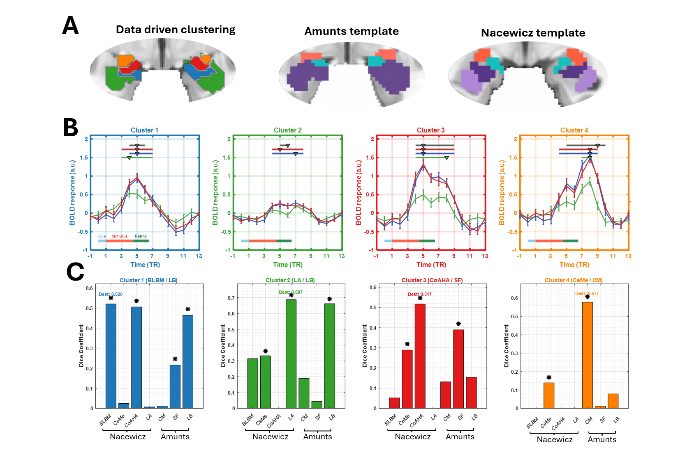
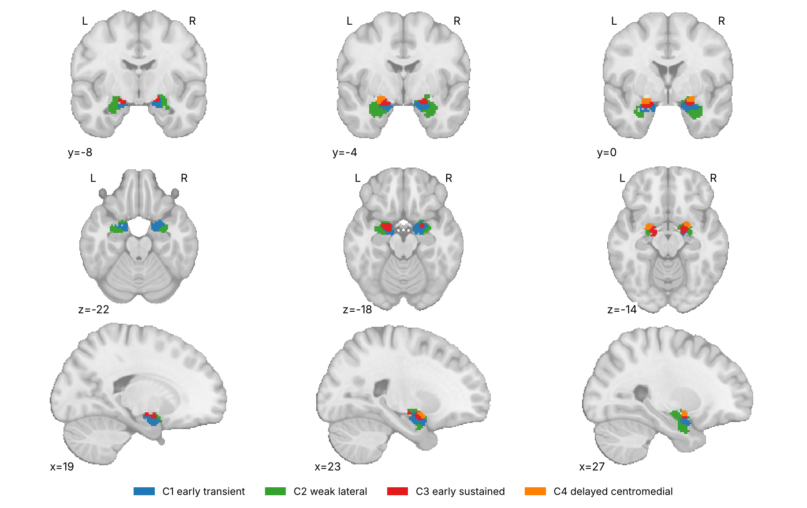
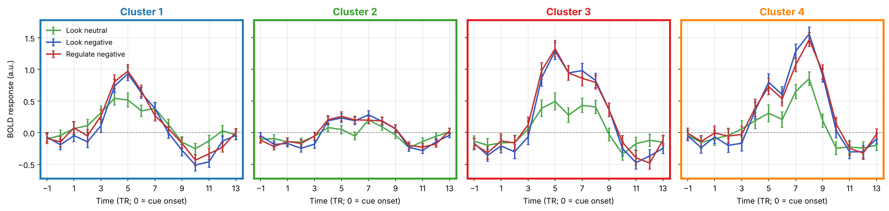

# Data-driven amygdala temporal-profile clusters (Bo et al. 2026)

## Overview

Four amygdala clusters defined only by **when** voxels respond to
negative pictures, with no anatomical labels used to make them. All 958
voxels in the union of the Amunts (CANlab 2018) and Nacewicz amygdala
masks were grouped with k-means (k = 4, squared Euclidean distance) on
their group-mean finite impulse response (FIR) time courses: 15 TRs
(TR = 2 s) for each of Look Neutral, Look Negative and Regulate
Negative, a 45-value profile per voxel, averaged over **N = 358**
participants from two independent cohorts (AHAB, *n* = 182; PIP,
*n* = 176). k = 4 was chosen by a permutation test on the mean
silhouette value (pseudo-Z; `clusterdata_permtest` in CanlabCore).

| Cluster | Voxels | Temporal profile | Nacewicz match (Dice) | Amunts match (Dice) |
| --- | --- | --- | --- | --- |
| **C1** early transient | 255 | Look Negative peaks at TR 5 and returns to baseline; no late peak | BLBM 0.520, CoAHA 0.505 | LB 0.465 |
| **C2** weak lateral | 474 | Weakest evoked response; modest negative vs. neutral difference | LA 0.687 | LB 0.662 |
| **C3** early sustained | 140 | Robust early peak (TR 5) that stays elevated | CoAHA 0.517 (CeMe 0.289) | SF 0.389 |
| **C4** delayed centromedial | 89 | Most delayed; rises late and peaks at TR 8, into the post-stimulus rating period | CeMe 0.139 | CM 0.577 |

The partition agreed with both anatomical atlases well above chance
(adjusted Rand index 0.276 for Nacewicz and 0.161 for Amunts; both
permutation *p* < .0001) while crossing some nuclear boundaries.
Clustering each cohort separately reproduced it (AHAB vs. PIP
ARI = 0.369), and the delayed centromedial cluster (C4) overlapped
Amunts CM at Dice = 0.578 in both cohorts. C4 is the data-driven
counterpart of the paper's main finding: a sustained centromedial
response that follows the earlier laterobasal and superficial
responses.

**Primary reference.** Bo, K., Lindquist, M. A., Gianaros, P. J., &
Wager, T. D. (2026). *Spatiotemporal dissociation of human amygdala
response to negative affect.* **bioRxiv.**
[doi:10.64898/2026.08.18.745530](https://doi.org/10.64898/2026.08.18.745530)
· [local PDF](./Bo_2026_amygdala_spatiotemporal_FIR.pdf)



Figure 5 from the paper. **A**, cluster locations (C1 blue, C2 green,
C3 red, C4 orange) beside the Amunts and Nacewicz atlases. **B**, mean
FIR time course of each cluster (green Look Neutral, blue Look
Negative, red Regulate Negative; ±SEM; TR 0 = cue onset). **C**, Dice
overlap with each anatomical subregion; asterisks mark overlaps above
a permutation null (FDR *q* < .05).

| Clusters, paper colors | Cluster time courses |
| --- | --- |
|  |  |

Regenerate with [`visualize_contents.m`](./visualize_contents.m), which
also writes the standard atlas montage and isosurface.

## How to load

Not registered in `load_atlas`. Load the atlas object directly:

```matlab
S   = load(which('Bo2026_AmygdalaFIR_4clusters_atlas_object.mat'));
atl = S.atlas_obj;                 % CANlab atlas, 4 regions
orthviews(atl);

% One cluster, e.g. the delayed centromedial cluster
c4 = select_atlas_subset(atl, {'AmyFIR_C4'});

% Cluster-average signal from your own images
dat = fmri_data(my_image_files);
cluster_means = apply_parcellation(dat, atl);   % images x 4

% Left/right versions, if you need them (clusters are bilateral)
atl_lr = split_atlas_by_hemisphere(atl);
```

Or load the label image or a single binary mask:

```matlab
atl = atlas(which('Bo2026_AmygdalaFIR_4clusters_atlas_regions.nii.gz'));
c4  = fmri_data(which('Bo2026_AmygdalaFIR_C4_delayed_centromedial.nii.gz'));
```

The masks are in 2 mm MNI152 space (SPM12 normalization; the standard
91 × 109 × 91 grid). CANlab functions resample them to your data's space
automatically. Because the clusters are small (89–474 voxels), check
the overlap after resampling to coarser or non-MNI-aligned data.

`Bo2026_AmygdalaFIR_cluster_timecourses.csv` holds the group-mean
time course behind Figure 5B: one row per cluster × condition × TR,
with columns `cluster`, `cluster_label`, `condition`, `fir_bin`
(1–15), `tr_rel_cue` (−1 to 13; 0 = cue onset), `mean_beta`, `sem`
and `n_subjects`.

## How the clusters were made

[`Bo2026_AmygdalaFIR_create_atlas_object.m`](./Bo2026_AmygdalaFIR_create_atlas_object.m)
is the full pipeline and writes every file in this folder: group-mean
FIR features, choice of k (`clusterdata_permtest`, k = 2–7, 1,000
permutations), k-means, mapping back to the brain, the comparison with
the Nacewicz and Amunts atlases (ARI and Dice, 10,000 permutations, FDR
q < .05), and the masks, atlas object and time-course table.

k-means starts from random centroids, so a fresh run can differ from the
paper's by a few voxels on cluster borders. The exact assignment used in
the paper is stored in `Bo2026_AmygdalaFIR_cluster_idx.csv`, and the
script uses it by default. The files here reproduce every cluster size,
ARI and Dice value reported in the paper. The voxelwise FIR estimates
the script starts from will be released with the paper; the full
analysis code will be posted at
[KeBo2018/KeBo2026_Amygdala_HRF](https://github.com/KeBo2018/KeBo2026_Amygdala_HRF).

## File inventory

| File | Type | What it is |
| --- | --- | --- |
| `Bo2026_AmygdalaFIR_4clusters_atlas_object.mat` | MAT (`atlas`) | `atlas_obj` with the 4 clusters, labels, long descriptions and the reference. |
| `Bo2026_AmygdalaFIR_4clusters_atlas_regions.nii.gz` | NIfTI | Integer label image: 1 = C1 … 4 = C4, 0 = outside. |
| `Bo2026_AmygdalaFIR_4clusters_atlas_regions.mat` | MAT (`region`) | `region` objects, one variable per cluster, for `canlab_load_ROI`. |
| `Bo2026_AmygdalaFIR_C1_early_transient.nii.gz` | NIfTI | Binary mask, cluster 1. |
| `Bo2026_AmygdalaFIR_C2_weak_lateral.nii.gz` | NIfTI | Binary mask, cluster 2. |
| `Bo2026_AmygdalaFIR_C3_early_sustained.nii.gz` | NIfTI | Binary mask, cluster 3. |
| `Bo2026_AmygdalaFIR_C4_delayed_centromedial.nii.gz` | NIfTI | Binary mask, cluster 4. |
| `Bo2026_AmygdalaFIR_cluster_timecourses.csv` | CSV | Group-mean FIR time course (±SEM, N = 358) per cluster × condition × TR. |
| `Bo2026_AmygdalaFIR_cluster_idx.csv` | CSV | The paper's cluster (1–4) for each of the 958 voxels, in the row order of the source FIR data. |
| `Bo2026_AmygdalaFIR_create_atlas_object.m` | MATLAB | Full pipeline: how the clusters were made; writes every file above. |
| `Bo_2026_amygdala_spatiotemporal_FIR.pdf` | PDF | The paper. |
| `visualize_contents.m` | MATLAB | Regenerates `png_images/`. |

## Citations

- Bo K, Lindquist MA, Gianaros PJ, Wager TD (2026). Spatiotemporal
  dissociation of human amygdala response to negative affect.
  *bioRxiv*.
  [doi:10.64898/2026.08.18.745530](https://doi.org/10.64898/2026.08.18.745530)
- Amunts K et al. (2005). Cytoarchitectonic mapping of the human
  amygdala, hippocampal region and entorhinal cortex: intersubject
  variability and probability maps. *Anat Embryol* 210:343–352.
- Nacewicz BM, Alexander AL, Kalin NH, Davidson RJ (2014). The
  neurochemical underpinnings of human amygdala volume including
  subregional contributions. Society of Biological Psychiatry annual
  meeting, New York.
- Wager TD, Davidson ML, Hughes BL, Lindquist MA, Ochsner KN (2008).
  Prefrontal-subcortical pathways mediating successful emotion
  regulation. *Neuron* 59:1037–1050. (Permutation test for the number
  of clusters.)
- Hubert L, Arabie P (1985). Comparing partitions. *J Classif*
  2:193–218. (Adjusted Rand index.)
