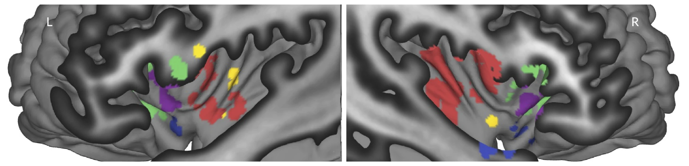

# Domain-general and domain-selective insular zones (Kwon et al. 2026)

## Overview

Binary masks of five functional zones in the human insula, identified with voxel-wise **Bayes factors** in a mega-analysis of participant-level fMRI contrast maps from the Affective Neuroimaging Consortium (ANiC) database (**N = 540** participants from **36 studies**). The analysis covered four domains (**pain**, **appetitive processes**, **aversive processes** and **cognitive control**), with three subdomains per domain (e.g., thermal, visceral and mechanical pain), three studies per subdomain and 15 participants per study.

- **Domain-general zone** (`ins_gen.nii`): activated in all four domains; bilateral dorsal anterior insula.
- **Domain-selective zones**: activated in one domain, with evidence for *no* activation in the other three:
  - **Pain-selective** (`ins_pain_sel.nii`): bilateral mid-posterior insula.
  - **Appetitive-selective** (`ins_posemo_sel.nii`): left dorsal and bilateral ventral mid-insula.
  - **Aversive-selective** (`ins_negemo_sel.nii`): ventral anterior insula, bilateral.
  - **Cognitive control-selective** (`ins_cog_sel.nii`): anterior-most dorsal anterior insula, anterior and dorsal to the domain-general zone.

Bayes factors (one-sample Bayes factor t-tests, n = 135 per domain) were computed within an anatomically defined insula mask (6,012 voxels). A voxel counts as **activated** in a domain when BF > 4.32 (corresponding to FDR q < 0.01 on average across domains) and t > 0. It counts as **not activated** when BF < 0.23 (= 1/4.32), or when BF > 4.32 with t < 0.

## Key image

All five zones on insular cutaway surfaces (adapted from Fig. 3 of the paper), in the colors used in the paper: domain-general **purple**, pain-selective **red**, appetitive-selective **yellow**, aversive-selective **blue**, cognitive control-selective **green**.

## Citation

Kwon, M., Bo, K., Botvinik-Nezer, R., Kragel, P. A., Van Oudenhove, L., Wager, T. D., & the Affective Neuroimaging Consortium (2026). *Convergent and selective representations of pain, appetitive processes, aversive processes, and cognitive control in the insula.* **Nature Communications, 17**, 5186. [doi:10.1038/s41467-026-71568-9](https://doi.org/10.1038/s41467-026-71568-9)
