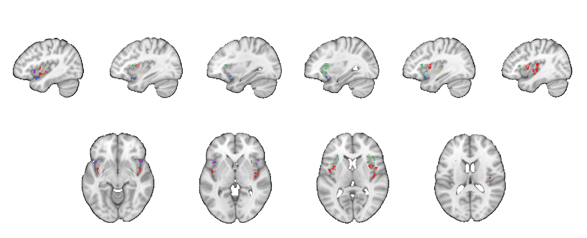

# Domain-general and domain-selective insular zones (Kwon et al. 2026, Nat Commun)

## Overview

Binary masks of five functional zones in the human insula, identified
with voxel-wise **Bayes factors** in a mega-analysis of participant-level
fMRI contrast maps from the Affective Neuroimaging Consortium
([ANiC](https://www.anic.science)) database (**N = 540** participants,
**36** study contrasts). The design is balanced across four domains, each
with three subdomains, three studies per subdomain and 15 participants
per study:

| Domain | Subdomains |
| --- | --- |
| **Pain** (somatic) | thermal, mechanical, visceral |
| **Appetitive processes** (non-somatic) | food, drug and sexual images |
| **Aversive processes** (non-somatic) | negative images, aversive sounds, negative social interactions |
| **Cognitive control** | working memory, response inhibition, attention switching |

One-sample Bayes factor *t*-tests (*n* = 135 per domain) were run within
an anatomical insula mask (6,012 voxels). A voxel counts as **activated**
in a domain when BF > 4.32 (equivalent on average to FDR *q* < 0.01) and
*t* > 0, and as **not activated** when BF < 0.23 (= 1/4.32), or when
BF > 4.32 with *t* < 0 (significant deactivation).

- **Domain-general** voxels are activated in all four domains. They form
  a multi-domain convergence zone in bilateral dorsal anterior insula
  (dAIns).
- **Domain-selective** voxels are activated in one domain and show
  evidence for no activation in the other three.

The zones replicated in independent validation datasets (*n* = 608). The
paper also shows partially convergent (two- and three-domain) zones that
form progressively around the dAIns hub; those maps are not included
here.

**Primary reference.** Kwon, M., Bo, K., Botvinik-Nezer, R., Kragel,
P. A., Van Oudenhove, L., Wager, T. D., & the Affective Neuroimaging
Consortium (2026). *Convergent and selective representations of pain,
appetitive processes, aversive processes, and cognitive control in the
insula.* **Nature Communications, 17**, 5186.
[doi:10.1038/s41467-026-71568-9](https://doi.org/10.1038/s41467-026-71568-9)
· [local PDF](./Kwon_2026_insula_convergent_selective.pdf)

The folder's [README](./README.md) gives a shorter summary.


Insular cutaway surfaces adapted from Fig. 3 of the paper: domain-general
**purple**, pain-selective **red**, appetitive-selective **yellow**,
aversive-selective **blue**, cognitive control-selective **green**.



The same five zones in the same colors on sagittal and axial slices,
rendered by [`visualize_contents.m`](./visualize_contents.m). It also
writes one montage per zone to `png_images/`.

## How to load

Not registered in `load_image_set` or `load_atlas`. Load each mask
directly:

```matlab
ins_gen    = fmri_data(which('ins_gen.nii'));          % domain-general
ins_pain   = fmri_data(which('ins_pain_sel.nii'));     % pain-selective
ins_posemo = fmri_data(which('ins_posemo_sel.nii'));   % appetitive-selective
ins_negemo = fmri_data(which('ins_negemo_sel.nii'));   % aversive-selective
ins_cog    = fmri_data(which('ins_cog_sel.nii'));      % cognitive control-selective

% Example: mean activity in the domain-general zone for a set of images
% dat = fmri_data(my_images);
% zone_means = extract_roi_averages(dat, ins_gen);

% Example: contiguous clusters as a region object
r = region(ins_gen);
```

## File inventory

All masks are binary (0/1), 79 × 95 × 68 voxels at 2 mm in MNI space.

| File | Type | Voxels | What it is |
| --- | --- | --- | --- |
| `ins_gen.nii` | NIfTI | 120 | Domain-general zone, activated in all four domains; bilateral dorsal anterior insula. |
| `ins_pain_sel.nii` | NIfTI | 320 | Pain-selective zone; bilateral mid-posterior insula (middle short to posterior long gyrus). |
| `ins_posemo_sel.nii` | NIfTI | 14 | Appetitive-selective zone; left dorsal and bilateral ventral mid-insula (anterior and posterior long gyri). |
| `ins_negemo_sel.nii` | NIfTI | 75 | Aversive-selective zone; ventral-most bilateral anterior insula (anterior inferior gyrus). |
| `ins_cog_sel.nii` | NIfTI | 142 | Cognitive control-selective zone; anterior-most dorsal anterior insula, anterior and dorsal to the domain-general zone. |
| `Kwon_2026_insula_convergent_selective.pdf` | PDF | — | Primary paper (open access, CC BY 4.0). |
| `README.md` | Markdown | — | Short summary supplied with the masks. |
| `visualize_contents.m` | MATLAB | — | Generates `png_images/`. |

## Citations

- Kwon, M., Bo, K., Botvinik-Nezer, R., Kragel, P. A., Van Oudenhove, L.,
  Wager, T. D., & the Affective Neuroimaging Consortium (2026).
  Convergent and selective representations of pain, appetitive
  processes, aversive processes, and cognitive control in the insula.
  *Nature Communications, 17*, 5186.
  [doi:10.1038/s41467-026-71568-9](https://doi.org/10.1038/s41467-026-71568-9)
- Participant-level data for 16 of the main-analysis studies:
  [figshare doi:10.6084/m9.figshare.24033402.v2](https://doi.org/10.6084/m9.figshare.24033402.v2);
  studies 3 and 6: [NeuroVault collection 8707](https://neurovault.org/collections/8707/).
- The Bayes-factor systems-identification approach follows Bo et al.
  (2024) *Nat Neurosci*
  [doi:10.1038/s41593-024-01605-7](https://doi.org/10.1038/s41593-024-01605-7);
  see [`2024_Bo_EmotionRegulation_BayesFactor`](../2024_Bo_EmotionRegulation_BayesFactor/contents_description.md).
